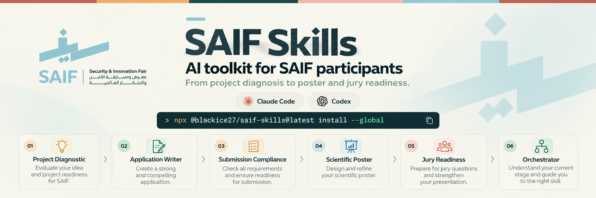

<p align="center">
  
</p>

# SAIF Skills

[](https://github.com/blackice2090/saif-skills/actions/workflows/ci.yml)
[](https://www.npmjs.com/package/@blackice27/saif-skills)
[](https://www.npmjs.com/package/@blackice27/saif-skills)
[](LICENSE)

A focused Agent Skills pack for **SAIF 2026** that takes a contestant from project diagnosis to application writing, scientific poster preparation and presentation, submission compliance, and jury readiness.

> **Unofficial community toolkit.** This repository is not an official SAIF, Tuwaiq Academy, or organizer product. Competition requirements inside the skills are grounded in the supplied SAIF materials. Advisory scoring and coaching logic are clearly separated from official requirements.

## Quick start

### Claude Code

Project install:

```bash
npx @blackice27/saif-skills@latest install
```

Global install:

```bash
npx @blackice27/saif-skills@latest install --global
```

### Codex

Project install:

```bash
npx @blackice27/saif-skills@latest install --platform codex
```

Global install:

```bash
npx @blackice27/saif-skills@latest install --platform codex --global
```

### Verify the installation

```bash
npx @blackice27/saif-skills@latest doctor --global
```

For a project-local install, omit `--global`.

## What gets installed

| Skill | Purpose |
|---|---|
| `saif-orchestrator` | Routes the contestant through the right stage without overwhelming them |
| `saif-project-diagnostic` | Evaluates idea/project completeness, evidence, innovation, methodology, readiness, and track fit |
| `saif-application-writer` | Produces precise English portal content, including the 500-character marketing summary |
| `saif-submission-compliance` | Audits portal, team, files, Drive, IP, previous participation, and final submission requirements |
| `saif-scientific-poster` | Builds and audits the scientific poster using the supplied SAIF template/guidance |
| `saif-poster-presentation` | Rehearses clear, evidence-based poster explanations and visitor/judge conversations |
| `saif-jury-readiness` | Red-teams claims and prepares evidence-backed answers for judge questions |

The seven-skill journey is: **diagnose the project → write the application → check submission compliance → build the poster → present and rehearse the poster → prepare for judge questions**. The orchestrator routes to the relevant stage based on what the contestant needs now.

Shared references are installed automatically with the skills.

## Install selected skills only

```bash
npx @blackice27/saif-skills@latest install \
  --only saif-orchestrator,saif-project-diagnostic
```

## Installation paths

| Agent | Project | Global |
|---|---|---|
| Claude Code | `./.claude/skills/` | `~/.claude/skills/` |
| Codex | `./.codex/skills/` | `~/.codex/skills/` |

You can also choose any directory:

```bash
npx @blackice27/saif-skills@latest install --target ./my-skills
```

## CLI

```text
saif-skills install [options]
saif-skills update [options]
saif-skills doctor [options]
saif-skills list
saif-skills where [options]
saif-skills uninstall [options]
saif-skills self-test
```

Useful options:

```text
--platform claude|claude-code|codex
--global
--target <path>
--only <skill-a,skill-b>
--force
```

## Update

Update all installed SAIF Skills to the latest published version.

Claude Code:

```bash
npx @blackice27/saif-skills@latest update --global
```

Codex:

```bash
npx @blackice27/saif-skills@latest update --platform codex --global
```

The update command replaces the SAIF-managed skill and reference files with the latest version.

## Uninstall

Claude Code global install:

```bash
npx @blackice27/saif-skills@latest uninstall --global
```

Codex global install:

```bash
npx @blackice27/saif-skills@latest uninstall --platform codex --global
```

## Repository structure

```text
saif-skills/
├─ bin/
│  └─ saif-skills.js
├─ skills/
│  ├─ saif-orchestrator/SKILL.md
│  ├─ saif-project-diagnostic/SKILL.md
│  ├─ saif-application-writer/SKILL.md
│  ├─ saif-submission-compliance/SKILL.md
│  ├─ saif-scientific-poster/SKILL.md
│  ├─ saif-poster-presentation/SKILL.md
│  └─ saif-jury-readiness/SKILL.md
├─ references/
│  ├─ official_submission_rules.md
│  ├─ judge_video_notes.md
│  ├─ poster_presentation_notes.md
│  ├─ project_readiness_model.md
│  └─ source_map.md
├─ .github/workflows/
├─ package.json
└─ README.md
```

## Design principles

The skills deliberately separate four different things:

- **Official requirements:** rules supported by the supplied SAIF materials.
- **Expert guidance:** advice extracted from the supplied judge/expert video notes.
- **Training examples:** hypothetical results, scenarios, and context-specific timing examples; these are not project facts or official rules.
- **Internal coaching:** readiness scoring, red-team questions, and improvement plans. These are not represented as official SAIF judging criteria.

A submission can therefore be administratively complete while still being scientifically weak, or technically strong while still failing an official submission requirement. The toolkit treats those as separate states.

## Development

Requirements: Node.js 18 or newer.

```bash
git clone https://github.com/blackice2090/saif-skills.git
cd saif-skills
npm install
npm test
npm pack --dry-run
```

To test the local package without publishing:

```bash
npm pack
npx ./blackice27-saif-skills-0.2.0.tgz install --target ./tmp-skills
node ./bin/saif-skills.js doctor --target ./tmp-skills
```

## Versioning

This project follows semantic versioning:

- `PATCH` for corrections and non-breaking guidance updates.
- `MINOR` for new skills/features or compatible CLI capabilities.
- `MAJOR` for breaking CLI, directory-layout, or skill-contract changes.

Before publishing a release:

```bash
npm test
npm pack --dry-run
npm version minor   # or patch / major
git push --follow-tags
```

## Publish to npm

The package name is:

```text
@blackice27/saif-skills
```

First-time/manual publish:

```bash
npm login
npm whoami
npm test
npm publish --access public
```

The repository also contains a GitHub Actions publish workflow. Add an `NPM_TOKEN` repository secret before using that workflow, or configure npm Trusted Publishing and adjust the workflow accordingly.

## Contributing

Contributions are welcome. See [CONTRIBUTING.md](CONTRIBUTING.md).

## License

MIT. See [LICENSE](LICENSE).


